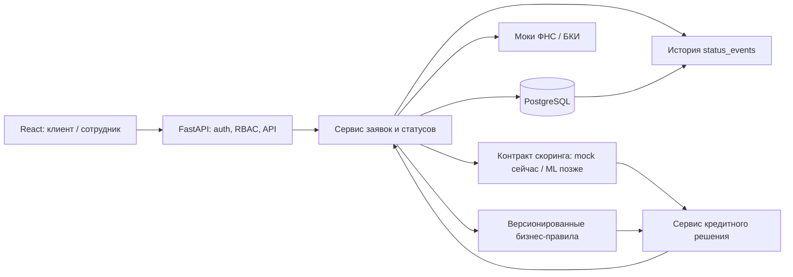

# MVP «Умный кредитный кабинет»

Статус: проект целевой архитектуры при частичной реализации. Сейчас в backend есть FastAPI, `GET /health`, Swagger `/docs`, Dockerfile, CI и 10 тестов; БД, авторизация, заявки, FSM, моки, скоринг и правила ещё не реализованы. Все данные, организации, пользователи, кредитные предложения и ответы внешних источников в MVP синтетические. Это демонстрационный продукт, а не реальная выдача кредита или интеграция с Альфа-Банком.

## Цель и границы

Клиенту малого бизнеса нужна понятная последовательность: подобрать один из двух кредитных продуктов, заполнить заявку, увидеть решение и историю её обработки. Сотруднику банка нужен отдельный рабочий список заявок, возможность запросить уточнение и зафиксировать итог в рамках разрешённых действий. MVP показывает полный путь на синтетических данных.

Входят: оборотный и инвестиционный кредиты; объяснимая помощь в выборе; черновик и подача заявки; синтетические моки ФНС и БКИ; детерминированный mock оценки риска дефолта с контрактом будущей ML-модели; отдельные бизнес-правила и автоматическое либо ручное решение; одобрение, отказ, уточнение и альтернативные условия; текущий статус и история фактических переходов; локальная имитация подписания и выдачи.

Не входят: новостная лента, реальные клиенты и персональные/банковские данные, реальные вызовы ФНС/БКИ, ЭЦП, настоящее подписание договора и перевод денег, обслуживание после выдачи, бухгалтерская интеграция, промышленная проверка личности и действующая кредитная политика банка. Тексты и условия демонстрационные; внешние SMS не используются.

## Роли и доступ

| Действие | Клиент | Сотрудник |
| --- | --- | --- |
| Просмотр каталога и подсказки по продукту | Да | Да |
| Создание, изменение и подача заявки | Только своей организации, пока разрешает статус | Нет |
| Просмотр заявки, статусов и решения | Только своей организации | Только назначенные/разрешённые заявки |
| Просмотр очереди и запрос уточнения | Нет | Да |
| Ручное решение и альтернативные условия для пограничной заявки | Нет | Да, с записью основания и аудитом |
| Просмотр текущего статуса и реальной истории переходов | Только своей организации | Только назначенные/разрешённые заявки |

Роли задаются сервером; идентификатор организации и права берутся из проверенной сессии, а не из параметров запроса. Для MVP допустима демонстрационная аутентификация с заранее созданными синтетическими учётными записями, но проверка прав на сервере обязательна. Сотрудник не получает глобальный доступ автоматически: область видимости определяется назначением/разрешением.

## Сценарии

1. **Выбор продукта.** Клиент отвечает на короткие вопросы о цели финансирования. Система показывает оборотный или инвестиционный кредит, причину рекомендации и оба доступных продукта. Подсказка не обещает одобрения и не является кредитным решением.
2. **Подача.** Клиент создаёт черновик, вводит сумму, срок, цель и необходимые синтетические сведения, проверяет сводку и отправляет заявку. Повторная отправка с тем же ключом идемпотентности не создаёт дубль.
3. **Оценка.** Backend фиксирует снимок входных данных и ответов моков, проверяет полноту данных, вызывает детерминированный `MockScorer` через общий контракт и отдельно запускает версионированные бизнес-правила. Скоринг выдаёт оценку риска, а не решение.
4. **Уточнение.** При недостатке данных система или сотрудник указывает конкретные поля/причину. Клиент получает запрос и досылает разрешённые сведения. Новая оценка использует новый снимок данных; прежняя остаётся в истории.
5. **Решение.** Низкорисковая заявка может получить автоматическое одобрение либо встречное предложение по демонстрационным бизнес-правилам. Пограничная попадает сотруднику для обоснованного ручного решения или альтернативных условий. Клиент может принять или отклонить предложение. Автор, правило/основание и переход фиксируются в аудите и `status_events`.
6. **Отслеживание, подписание и выдача.** Клиент видит текущий статус и реальные события своей заявки без фиктивной анимации. После принятия предложения возможны только локальные демо-подписание и демо-выдача; код показывается внутри продукта без внешних SMS, деньги не переводятся.

## Компоненты и поток данных

- **React** показывает только доступные пользователю действия, текущий статус и историю фактических переходов; источником прав и статусов служит API, фиктивная анимация обработки не используется.
- **FastAPI** сейчас предоставляет `/health` и `/docs`; будущий прикладной API проверяет аутентификацию, роль, владение/назначение для каждого объекта, валидирует запросы и выдаёт безопасные ошибки. Публичный nginx позже добавляет префикс `/api` без переименования текущих внутренних путей.
- **Домен заявок** управляет разрешёнными переходами статусов в транзакции, идемпотентностью подачи и журналом событий.
- **Моки ФНС/БКИ** имеют фиксированные контракты и воспроизводимые сценарии успеха, неполных данных, ошибки и задержки. Их ответ сохраняется как снимок с версией сценария и временем; внешний сетевой доступ не требуется.
- **Backend** отвечает за PostgreSQL, SQLAlchemy/Alembic, авторизацию и права, заявки и переходы, локальные моки ФНС/БКИ, вызов скоринга, бизнес-правила, кредитные решения, альтернативные условия, локальную имитацию подписания/выдачи и аудит.
- **Скоринг** за отдельным интерфейсом оценивает риск дефолта (`pd`, `risk_band`, `reasons`, `model_version`) и не принимает кредитное решение. `MockScorer` ещё не реализован; он должен быть детерминированным и явно помечать тестовые результаты. Создание синтетических обучающих данных, обучение, валидация и версионирование настоящей модели — ответственность отдельного ML-участника.
- **Бизнес-правила** независимо проверяют стоп-факторы, полноту данных, риск и нагрузку, возвращают коды причин и версию набора правил. Продукты, лимиты и пороги разделов 6 и 9 [00_common.md](00_common.md) — демонстрационные допущения, не политика банка.
- **Сервис решения** применяет версионированные правила к снимку заявки, мокам и скорингу: низкорисковые заявки могут получить автоматическое решение, пограничные направляются сотруднику. Любой исход проходит контролируемый переход с записью системного правила либо автора и основания. Ни модель, ни клиентский интерфейс не меняют итоговый статус напрямую.
- **PostgreSQL/SQLAlchemy/Alembic** хранят заявки, версии оценок, решения и неизменяемую историю переходов. Миграции и seed синтетических данных воспроизводимы. **Docker** запускает приложение и БД с фиксируемыми версиями образов и healthcheck; секреты передаются через окружение, без включения в образы.

Для MVP допустим один модульный FastAPI-сервис с явными границами модулей. Согласно [00_common.md](00_common.md) короткий демонстрационный конвейер выполняется синхронно при подаче; позже его можно вынести в фон, сохранив FSM и идемпотентность. Адаптер скоринга позволяет подключить модель ML-участника вместо mock без изменения бизнес-правил, сервиса решений и API заявок. Docker-запуск обязателен; публичное размещение желательно.

## Контракт скоринга и разделение ответственности

Единственный контракт скоринга — раздел 10 [00_common.md](00_common.md): `Scorer.score(req: ScoringRequest) -> ScoringResult`. Запрос содержит параметры кредита, компанию и ответы моков БКИ/ФНС; ответ содержит `pd`, `risk_band`, `model_version`, `reasons`. Производные признаки скорер считает из запроса одинаково при обучении и инференсе. `pd` — оценка риска дефолта, а не вероятность одобрения; скорер не возвращает статус заявки или кредитное решение.

Backend хранит входной снимок, источник результата (`mock`/`model`), версию и признак тестового mock-результата как метаданные запуска, не меняя контракт `ScoringResult`. Mock возвращает одинаковую оценку для одинакового входа и версии; тестовые сценарии документируются явно. Ошибка вызова хранится как ошибка оценки без `pd` и не превращается в отказ или одобрение. Контрактные тесты проверяют одинаковую семантику у mock и будущего ML-адаптера.

ML-участник поставляет версионированный артефакт/адаптер, описание признаков, происхождение синтетических обучающих данных и результаты валидации. Backend проверяет совместимость и фиксирует версию при каждом вызове. Только бизнес-правила и, для пограничных заявок, сотрудник формируют решение; статус меняется через серверную FSM.

## Ключевые сущности

| Сущность | Основные поля и назначение |
| --- | --- |
| `User`, `Organization`, `Membership` | Роль, принадлежность к организации, состояние учётной записи |
| `Product` | Тип `working_capital` / `investment`, демонстрационные параметры и версия условий |
| `Application` | Организация, продукт, сумма, срок, цель, текущий статус, версия для конкурентных изменений, автор и даты |
| `ApplicationSnapshot` | Снимок полей и входных данных на момент каждой подачи/повторной оценки |
| `ExternalCheck` | Источник-мок, версия сценария, результат/ошибка, время и связь со снимком |
| `ScoreRun` | Снимок, версия адаптера и признаков, тип `mock`/`model`, отметка тестового результата, `pd`, группа риска и причины либо ошибка |
| `RuleEvaluation` | Версия правил, коды срабатывания, результат и связь со снимком |
| `Decision` | Автоматический или ручной исход, версия правил либо сотрудник, основание, время, ссылки на оценку и предложенные условия |
| `StatusEvent` (`status_events`) | Заявка, статус до/после, инициатор, причина, время; запись добавляется при каждом фактическом переходе |
| `AuditEvent` | Кто, что, над каким объектом и когда сделал, результат и correlation ID без секретов и лишних финансовых полей |

Снимки и версии нужны для повторяемости решения. Контракт [00_common.md](00_common.md) задаёт деньги в целых рублях; внутри расчётов нельзя использовать неточную арифметику для денежных итогов. Для записей решений и событий предпочтительна append-only модель; исправление оформляется новым событием, а не перезаписью истории.

## Статусы и переходы заявки

Единственная FSM — раздел 8 [00_common.md](00_common.md). Она содержит `draft`, `submitted`, `checking`, `scoring`, `decision`, `needs_info`, `manual_review`, `approved`, `counter_offer`, `accepted`, `signed_demo`, `disbursed_demo`, `rejected`, `closed`; там же заданы переходы по ролям и терминальные состояния. Backend проверяет каждый переход и атомарно пишет его в `status_events`, сохраняя историю даже после досылки сведений. Frontend читает текущий статус и фактическую историю, не рисуя несуществовавшие переходы.

Ошибка мока или скоринга — техническое состояние попытки оценки, а не отказ клиенту: повтор ограничен, а при неустранимом сбое требуется ручной разбор без ложного кредитного исхода. Все изменения статуса проверяются серверной FSM с optimistic locking и одной транзакцией для текущего статуса, `status_events` и аудита.

## Допущения, требующие утверждения

- Условия продуктов, диапазоны сумм/сроков, лимиты и пороги определены для демо в разделах 6 и 9 [00_common.md](00_common.md); все эти значения — демонстрационные допущения, а не политика Альфа-Банка.
- Низкорисковые заявки могут получать автоматическое решение по версионированным правилам; пограничные передаются сотруднику.
- Альтернативные условия можно принять или отклонить в интерфейсе; последующие подписание и выдача только локально имитируются с демонстрационным договором и графиком, без внешнего SMS и перевода средств.
- Для демонстрации достаточно одной организации на клиентскую учётную запись и предварительно назначенной очереди сотрудника.
- Метрика бинарной модели, учебная синтетическая выборка и объяснение результата согласуются с ML-участником отдельно; версия модели и данных обязательны для каждого запуска настоящей модели. До её приёмки используется только помеченный mock.

## Критерии готовности MVP

1. Два изолированных интерфейса ролей; прямой запрос к чужой заявке/действию возвращает отказ и не раскрывает объект.
2. Клиент проходит выбор, черновик, подачу и просмотр истории по обоим продуктам; подсказка объясняет выбор.
3. Синтетические моки воспроизводят успешный, неполный и ошибочный ответ; оценка сохраняет версии входа, адаптера скоринга и правил. Mock детерминирован, явно помечен как тестовый, его сценарии и ожидаемые результаты проверены. Повтор запуска не создаёт противоречивых итогов.
4. Контракт скоринга из `00_common.md` покрыт тестами; оценка риска, бизнес-правила и решение представлены разными результатами. Замена mock на совместимый ML-адаптер не требует изменения бизнес-логики. Доступны одобрение, отказ, уточнение, альтернативные условия и ручное рассмотрение.
5. Недопустимые переходы, повторные запросы и конкурентное изменение не нарушают `status_events`; каждое реальное изменение статуса и решение аудируется. Frontend показывает текущий статус и историю без фиктивной анимации.
6. Локальные демо-подписание и демо-выдача завершают сквозной сценарий без внешних SMS и движения денег; демонстрационные данные можно пересоздать командой запуска/seed.
7. Сервис поднимается через Docker, миграции применяются с чистой БД, healthcheck проходит; есть автоматические проверки критических прав, переходов, решения и обработки ошибок. Публичное размещение желательно.

Связанная модель угроз: [threat-model.md](threat-model.md).
