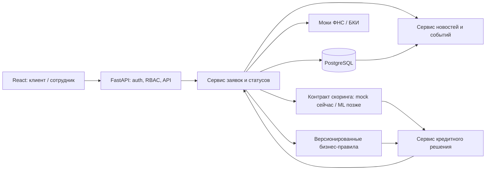

# MVP «Умный кредитный кабинет»

Статус: проект архитектуры до разработки. Репозиторий на момент составления содержит только каркас каталогов и README; приведённые интерфейсы и правила ещё не реализованы. Все данные, организации, пользователи, кредитные предложения и ответы внешних источников в MVP синтетические. Это демонстрационный продукт, а не реальная выдача кредита или интеграция с Альфа-Банком.

## Цель и границы

Клиенту малого бизнеса нужна понятная последовательность: подобрать один из двух кредитных продуктов, заполнить заявку, увидеть решение и историю её обработки. Сотруднику банка нужен отдельный рабочий список заявок, возможность запросить уточнение и зафиксировать итог в рамках разрешённых действий. MVP показывает полный путь на синтетических данных.

Входят: оборотный и инвестиционный кредиты; объяснимая помощь в выборе; черновик и подача заявки; синтетические моки ФНС и БКИ; детерминированный mock прогноза риска дефолта с контрактом будущей ML-модели; отдельные бизнес-правила и финальное решение; одобрение, отказ, уточнение и альтернативные условия; история статусов; персонализированная новостная лента.

Не входят: реальные клиенты и персональные/банковские данные, реальные вызовы ФНС/БКИ, ЭЦП, подписание договора, выдача денег, платёжный график, бухгалтерская интеграция, промышленная проверка личности и действующая кредитная политика банка. Тексты и условия демонстрационные.

## Роли и доступ

| Действие | Клиент | Сотрудник |
| --- | --- | --- |
| Просмотр каталога и подсказки по продукту | Да | Да |
| Создание, изменение и подача заявки | Только своей организации, пока разрешает статус | Нет |
| Просмотр заявки, статусов и решения | Только своей организации | Только назначенные/разрешённые заявки |
| Просмотр очереди и запрос уточнения | Нет | Да |
| Подтверждение решения или предложение альтернативы | Нет | Да, с записью основания и аудитом |
| Просмотр новостной ленты | Персональная лента своей организации | Служебное представление при необходимости |

Роли задаются сервером; идентификатор организации и права берутся из проверенной сессии, а не из параметров запроса. Для MVP допустима демонстрационная аутентификация с заранее созданными синтетическими учётными записями, но проверка прав на сервере обязательна. Сотрудник не получает глобальный доступ автоматически: область видимости определяется назначением/разрешением.

## Сценарии

1. **Выбор продукта.** Клиент отвечает на короткие вопросы о цели финансирования. Система показывает оборотный или инвестиционный кредит, причину рекомендации и оба доступных продукта. Подсказка не обещает одобрения и не является кредитным решением.
2. **Подача.** Клиент создаёт черновик, вводит сумму, срок, цель и необходимые синтетические сведения, проверяет сводку и отправляет заявку. Повторная отправка с тем же ключом идемпотентности не создаёт дубль.
3. **Оценка.** Backend фиксирует снимок входных данных и ответов моков, проверяет полноту данных, вызывает детерминированный mock scoring через общий контракт скоринга и отдельно запускает версионированные бизнес-правила. Результаты доступны сотруднику по отдельности.
4. **Уточнение.** При недостатке данных сотрудник указывает конкретные поля/причину. Клиент получает запрос, исправляет разрешённые поля и повторно отправляет заявку. Новая оценка использует новый снимок данных; прежняя остаётся в истории.
5. **Решение.** Уполномоченный сотрудник подтверждает одобрение/отказ либо предлагает альтернативные условия с причиной. Клиент видит результат и, для альтернативы, может принять или отклонить предложение. Полномочия и основание фиксируются в аудите.
6. **Отслеживание и лента.** Клиент видит текущий статус, последовательность событий и уведомления по своей заявке. Лента формируется из типа продукта, статуса и заранее заданных синтетических материалов; не раскрывает чужие данные.

## Компоненты и поток данных

- **React** показывает только доступные пользователю действия и состояния; источником прав и статусов служит API.
- **FastAPI** проверяет аутентификацию, роль, владение/назначение для каждого объекта, валидирует запросы и выдаёт безопасные ошибки. API документируется по OpenAPI.
- **Домен заявок** управляет разрешёнными переходами статусов в транзакции, идемпотентностью подачи и журналом событий.
- **Моки ФНС/БКИ** имеют фиксированные контракты и воспроизводимые сценарии успеха, неполных данных, ошибки и задержки. Их ответ сохраняется как снимок с версией сценария и временем; внешний сетевой доступ не требуется.
- **Backend** отвечает за PostgreSQL, SQLAlchemy/Alembic, авторизацию и права, заявки и переходы, локальные моки ФНС/БКИ, вызов скоринга, бизнес-правила, кредитные решения, альтернативные условия, новостную ленту и аудит.
- **Скоринг** за отдельным интерфейсом оценивает только риск дефолта (`0` — низкий, `1` — высокий) и выдаёт технические метаданные. Пока backend подключает детерминированный mock с явно помеченными тестовыми результатами; результат не является кредитным решением. Создание синтетических обучающих данных, обучение, валидация и версионирование настоящей модели — ответственность отдельного ML-участника.
- **Бизнес-правила** независимо проверяют формальные условия и полноту данных, возвращают коды срабатывания и версию набора правил. Пороговые значения и перечень правил — только демонстрационные допущения до согласования.
- **Сервис решения** принимает снимки заявки, моков, скоринга и правил; формирует рекомендацию с объяснимыми кодами причин. Окончательное действие сотрудника проводится отдельно через контролируемый переход с записью автора и основания. Ни модель, ни клиентский интерфейс не меняют итоговый статус напрямую.
- **PostgreSQL/SQLAlchemy/Alembic** хранят заявки, версии оценок, решения и неизменяемую историю переходов. Миграции и seed синтетических данных воспроизводимы. **Docker** запускает приложение и БД с фиксируемыми версиями образов и healthcheck; секреты передаются через окружение, без включения в образы.

Для MVP допустим один модульный FastAPI-сервис с явными границами модулей. Запуск оценки можно выполнять в фоне с сохраняемым состоянием задачи; обработка повторяющихся заданий должна быть идемпотентной. Адаптер скоринга позволяет подключить модель ML-участника вместо mock без изменения бизнес-правил, сервиса решений и API заявок.

## Контракт скоринга и разделение ответственности

Контракт между backend и любым адаптером скоринга версионируется отдельно от продукта и правил:

| Направление | Обязательные поля | Ограничение |
| --- | --- | --- |
| Запрос | `schema_version`, `application_snapshot_id`, `feature_schema_version`, типизированный набор синтетических признаков заявки и результатов моков | Признаки готовит backend из неизменного снимка; контракт фиксирует типы, единицы измерения, допустимые пропуски и порядок обработки неполных данных |
| Успешный ответ | `schema_version`, `scorer_kind` (`mock`/`model`), `scorer_version`, `feature_schema_version`, `application_snapshot_id`, `default_risk` (`0`/`1`), `is_test_result`, время расчёта | `1` означает прогноз повышенного риска дефолта, а не отказ; ответ не содержит статуса заявки, условий кредита или финального решения |
| Ошибка | Стабильный код ошибки и correlation ID; результат риска отсутствует | Ошибка не преобразуется в `0`/`1` и не трактуется как отказ или одобрение |

Опциональная вероятность допускается только после согласования её смысла и калибровки ML-участником; backend не выводит её как вероятность одобрения. Mock возвращает одинаковый результат для одинакового снимка и версии, а тестовые сценарии и ожидаемые классы документируются явно. Выбор сценария mock задаётся серверными синтетическими данными, а не произвольным полем клиента. Контрактные тесты должны подтверждать одинаковую семантику и обработку ошибок у mock и будущего ML-адаптера.

ML-участник поставляет версионированный артефакт/адаптер, описание схемы признаков, происхождение синтетических обучающих данных и результаты валидации. Backend проверяет совместимость контракта и фиксирует версию при каждом вызове; решение о допуске модели к демонстрации принимается отдельно. Ни прогноз риска, ни бизнес-правила сами по себе не меняют статус заявки: сервис решения объединяет их с данными заявки, после чего уполномоченный сотрудник фиксирует окончательный исход.

## Ключевые сущности

| Сущность | Основные поля и назначение |
| --- | --- |
| `User`, `Organization`, `Membership` | Роль, принадлежность к организации, состояние учётной записи |
| `Product` | Тип `working_capital` / `investment`, демонстрационные параметры и версия условий |
| `Application` | Организация, продукт, сумма, срок, цель, текущий статус, версия для конкурентных изменений, автор и даты |
| `ApplicationSnapshot` | Снимок полей и входных данных на момент каждой подачи/повторной оценки |
| `ExternalCheck` | Источник-мок, версия сценария, результат/ошибка, время и связь со снимком |
| `ScoreRun` | Снимок, версия схемы/адаптера и признаков, тип `mock`/`model`, отметка тестового результата, прогноз риска `0`/`1` либо ошибка |
| `RuleEvaluation` | Версия правил, коды срабатывания, результат и связь со снимком |
| `Decision` | Рекомендация системы, окончательный исход, автор, основание, время, ссылки на оценку и предложенные условия |
| `StatusEvent` | Заявка, статус до/после, инициатор, причина, время; запись добавляется при каждом переходе |
| `NewsItem`, `FeedEvent` | Синтетический материал/событие, критерии видимости, время публикации |
| `AuditEvent` | Кто, что, над каким объектом и когда сделал, результат и correlation ID без секретов и лишних финансовых полей |

Для денежных величин используются десятичные типы и явно заданная валюта. Снимки и версии нужны для повторяемости решения. Для записей решений и событий предпочтительна append-only модель; исправление оформляется новым событием, а не перезаписью истории.

## Статусы и переходы заявки

| Статус | Смысл | Разрешённый следующий статус |
| --- | --- | --- |
| `draft` | Черновик клиента | `submitted` |
| `submitted` | Подана, ожидает оценки | `evaluating`, `needs_information` |
| `evaluating` | Проверки выполняются | `under_review`, `needs_information` |
| `under_review` | Ожидает действия сотрудника | `needs_information`, `approved`, `declined`, `alternative_offered` |
| `needs_information` | Нужны конкретные сведения клиента | `submitted` после ответа клиента |
| `alternative_offered` | Предложены и зафиксированы другие условия | `alternative_accepted`, `alternative_declined` |
| `approved`, `declined`, `alternative_accepted`, `alternative_declined` | Конечные исходы MVP | Нет |

Ошибка мока или скоринга — техническое состояние попытки оценки, а не отказ клиенту: заявка остаётся в `evaluating` с ограниченным числом повторов либо переводится в `under_review` с явным признаком ручной проверки. Все переходы проверяются на сервере с optimistic locking и одной транзакцией для обновления текущего статуса и добавления события. Запрос уточнения не удаляет прошлое решение/оценку.

## Допущения, требующие утверждения

- Условия продуктов, диапазоны сумм/сроков и пороги решений пока не определены. Любые выбранные значения явно помечаются как демонстрационные допущения и не называются политикой Альфа-Банка.
- Сотрудник подтверждает окончательное решение; автоматическое одобрение не предполагается.
- Альтернативные условия можно принять или отклонить в интерфейсе без заключения договора и выдачи средств.
- Для демонстрации достаточно одной организации на клиентскую учётную запись и предварительно назначенной очереди сотрудника.
- Метрика бинарной модели, учебная синтетическая выборка и объяснение результата согласуются с ML-участником отдельно; версия модели и данных обязательны для каждого запуска настоящей модели. До её приёмки используется только помеченный mock.

## Критерии готовности MVP

1. Два изолированных интерфейса ролей; прямой запрос к чужой заявке/действию возвращает отказ и не раскрывает объект.
2. Клиент проходит выбор, черновик, подачу и просмотр истории по обоим продуктам; подсказка объясняет выбор.
3. Синтетические моки воспроизводят успешный, неполный и ошибочный ответ; оценка сохраняет версии входа, адаптера скоринга и правил. Mock детерминирован, явно помечен как тестовый, его сценарии и ожидаемые результаты проверены. Повтор запуска не создаёт противоречивых итогов.
4. Контракт скоринга покрыт тестами; прогноз риска дефолта, бизнес-правила и окончательное решение представлены разными результатами. Замена mock на совместимый ML-адаптер не требует изменения бизнес-логики. Доступны все четыре ветки: одобрение, отказ, уточнение, альтернативные условия.
5. Недопустимые переходы, повторные запросы и конкурентное изменение не нарушают историю статусов; решения и действия сотрудника аудируются.
6. Новостная лента учитывает продукт/статус, не содержит данных других организаций; демонстрационные данные можно пересоздать командой запуска/seed.
7. Сервис поднимается через Docker, миграции применяются с чистой БД, healthcheck проходит; есть автоматические проверки критических прав, переходов, решения и обработки ошибок.

Связанная модель угроз: [threat-model.md](threat-model.md).
