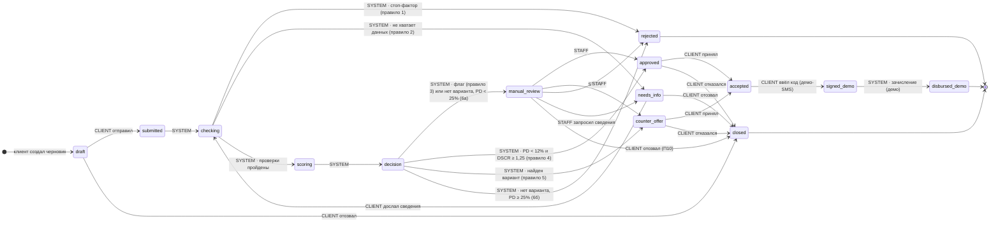

# Диаграмма состояний заявки (D2)

Backend — единственный источник правды о статусах. Таблица переходов в коде должна совпадать с этой один в один (рекомендуемый автотест — сверка FSM с таблицей).
Недопустимый переход → **409** `invalid_transition`. Каждый переход пишет `status_event` (дата, кто, комментарий) — из них строится история в карточке.

## Пять шагов для клиента

Внутренние этапы `checking / scoring / decision` клиенту не показываем — для него это «На рассмотрении».

| Шаг Stepper | Статусы |
|---|---|
| 1. Заявка | `draft` |
| 2. Рассмотрение | `submitted`, `checking`, `scoring`, `decision`, `needs_info`, `manual_review` |
| 3. Решение | `approved`, `counter_offer`, `rejected` |
| 4. Подписание | `accepted`, `signed_demo` |
| 5. Выдача | `disbursed_demo` |
| — | `closed` — Stepper останавливается на шаге, где заявку закрыли, с пометкой «Заявка закрыта» |

## Таблица переходов

Тексты в колонке «Что видит клиент» — заголовки экрана заявки во фронтенде (бейдж статуса в скобках).

| Из | В | Кто | Условие | Что видит клиент | Главное действие клиента |
|---|---|---|---|---|---|
| — | `draft` | CLIENT | «Сохранить черновик» в анкете | «Заявка сохранена» (Черновик) | «Отправить заявку» |
| `draft` | `submitted` | CLIENT | «Отправить заявку» | мгновенно сменяется следующим | — |
| `draft` | `closed` | CLIENT | Отмена черновика | «Заявка закрыта» | — |
| `submitted` | `checking` | SYSTEM | Всегда | «Рассматриваем вашу заявку» (На рассмотрении) | — |
| `checking` | `rejected` | SYSTEM | Стоп-фактор: ФНС ≠ действует, просрочка > 90 дн., дефолт | «По вашей заявке принято отрицательное решение» (Отказано) — без причин | «К моим заявкам» |
| `checking` | `needs_info` | SYSTEM | Нет объекта инвестиций или залога от 5 млн ₽ | «Дополните заявку» + список (Нужны сведения) | «Отправить сведения» |
| `checking` | `scoring` | SYSTEM | Проверки DATA, ФНС, БКИ пройдены | «Рассматриваем вашу заявку» | — |
| `needs_info` | `checking` | CLIENT | Дослал сведения | «Рассматриваем вашу заявку» | — |
| `needs_info` | `closed` | CLIENT | «Отозвать заявку» | «Заявка закрыта» | — |
| `scoring` | `decision` | SYSTEM | Скоринг выполнен | «Рассматриваем вашу заявку» | — |
| `decision` | `approved` | SYSTEM | Правило 4 | «Ваша заявка одобрена» + условия (Одобрено) | «Принять предложение» |
| `decision` | `counter_offer` | SYSTEM | Правило 5 | «Банк предлагает другие условия» + «Вы запрашивали → Банк предлагает» (Новое предложение) | «Принять предложение» |
| `decision` | `manual_review` | SYSTEM | Правило 3 или 6а | «Рассматриваем вашу заявку… Решение появится в кабинете» (На рассмотрении) | — |
| `decision` | `rejected` | SYSTEM | Правило 6б | «По вашей заявке принято отрицательное решение» | «К моим заявкам» |
| `manual_review` | `approved` | STAFF | Одобрил, внутренний комментарий обязателен | «Ваша заявка одобрена» — без комментария сотрудника (П12) | «Принять предложение» |
| `manual_review` | `counter_offer` | STAFF | Предложил другие условия | «Банк предлагает другие условия» | «Принять предложение» |
| `manual_review` | `rejected` | STAFF | Отказал | «По вашей заявке принято отрицательное решение» | «К моим заявкам» |
| `manual_review` | `needs_info` | STAFF | Запросил сведения | «Дополните заявку» + текст запроса | «Отправить сведения» |
| `manual_review` | `closed` | CLIENT | Отзыв заявки (П10; в интерфейсе кнопки пока нет) | «Заявка закрыта» | — |
| `approved` / `counter_offer` | `accepted` | CLIENT | «Принять предложение» | «Предложение принято» (Ожидает подписания) + договор и график | «Получить код» |
| `approved` / `counter_offer` | `closed` | CLIENT | «Отказаться от предложения» | «Заявка закрыта» | — |
| `accepted` | `signed_demo` | CLIENT | Галочка согласия + верный демо-код (5 мин) | «Договор подписан» (Оформляется выдача) | — |
| `signed_demo` | `disbursed_demo` | SYSTEM | Сразу после подписи | «Кредит выдан» (Кредит выдан (демо)): сумма, дата, счёт, ближайший платёж | — |

Терминальные статусы: `disbursed_demo`, `rejected`, `closed` — выходов нет; новая потребность — новая заявка.
