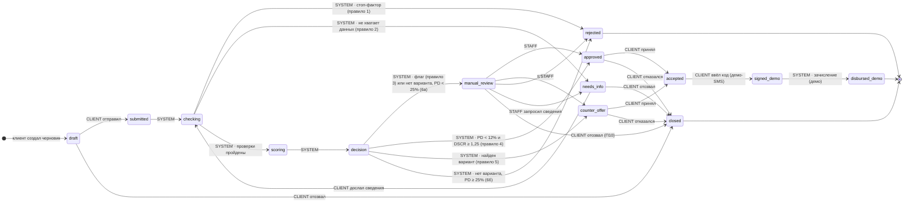

# Диаграмма состояний заявки (D2)

Backend — единственный источник правды о статусах. Таблица переходов в коде должна совпадать с этой один в один (рекомендуемый автотест — сверка FSM с таблицей).
Недопустимый переход → **409** `invalid_transition`. Каждый переход пишет `status_event` (дата, кто, комментарий) — из них строится история в карточке.

## Пять шагов для клиента

Внутренние этапы `checking / scoring / decision` клиенту не показываем — для него это «На рассмотрении».

| Шаг Stepper | Статусы |
|---|---|
| 1. Заявка | `draft` |
| 2. Рассмотрение | `submitted`, `checking`, `scoring`, `decision`, `needs_info`, `manual_review` |
| 3. Решение | `approved`, `counter_offer`, `rejected` |
| 4. Подписание | `accepted`, `signed_demo` |
| 5. Выдача | `disbursed_demo` |
| — | `closed` — Stepper останавливается на шаге, где заявку закрыли, с пометкой «Заявка закрыта» |

## Таблица переходов

| Из | В | Кто | Условие | Что видит клиент | Главная кнопка клиента |
|---|---|---|---|---|---|
| — | `draft` | CLIENT | Сохранил анкету | «Черновик сохранён» | «Отправить заявку» |
| `draft` | `submitted` | CLIENT | Нажал «Отправить», анкета валидна | «Заявка отправлена» (мгновенно сменяется следующим) | — |
| `draft` | `closed` | CLIENT | «Удалить черновик» | «Заявка закрыта» | «Подобрать кредит» |
| `submitted` | `checking` | SYSTEM | Всегда | «На рассмотрении» | — |
| `checking` | `rejected` | SYSTEM | Стоп-фактор: ФНС ≠ действующий, просрочка > 90 дн., дефолт | «Заявка отклонена» + причины + «Что можно сделать» | «Подобрать кредит» |
| `checking` | `needs_info` | SYSTEM | Нет объекта инвестиций или залога от 5 млн ₽ | «Нужны дополнительные сведения» + список | «Отправить сведения» |
| `checking` | `scoring` | SYSTEM | Проверки DATA, FNS, BKI без стоп-факторов и пробелов | «На рассмотрении» | — |
| `needs_info` | `checking` | CLIENT | Дослал сведения | «На рассмотрении» | — |
| `needs_info` | `closed` | CLIENT | «Отозвать заявку» | «Заявка закрыта» | «Подобрать кредит» |
| `scoring` | `decision` | SYSTEM | Скоринг выполнен | «На рассмотрении» | — |
| `decision` | `approved` | SYSTEM | Правило 4 | «Заявка одобрена» + условия | «Принять предложение» |
| `decision` | `counter_offer` | SYSTEM | Правило 5 | «Мы подготовили другое предложение» + «Вы просили → Мы предлагаем» | «Принять предложение» |
| `decision` | `manual_review` | SYSTEM | Правило 3 или 6а | «Заявку проверяет специалист» | — |
| `decision` | `rejected` | SYSTEM | Правило 6б | «Заявка отклонена» + причины | «Подобрать кредит» |
| `manual_review` | `approved` | STAFF | Одобрил, комментарий обязателен | «Заявка одобрена» + комментарий специалиста | «Принять предложение» |
| `manual_review` | `counter_offer` | STAFF | Предложил другие условия | «Мы подготовили другое предложение» | «Принять предложение» |
| `manual_review` | `rejected` | STAFF | Отказал | «Заявка отклонена» + комментарий специалиста | «Подобрать кредит» |
| `manual_review` | `needs_info` | STAFF | Запросил сведения | «Специалист просит уточнить» + текст запроса | «Отправить сведения» |
| `manual_review` | `closed` | CLIENT | «Отозвать заявку» (добавлено командой 26.10, П10) | «Заявка закрыта» | «Подобрать кредит» |
| `approved` | `accepted` | CLIENT | Принял оффер | «Осталось подписать договор» | «Получить код» |
| `approved` | `closed` | CLIENT | Отказался | «Заявка закрыта» | «Подобрать кредит» |
| `counter_offer` | `accepted` | CLIENT | Принял встречное | «Осталось подписать договор» | «Получить код» |
| `counter_offer` | `closed` | CLIENT | Отказался | «Заявка закрыта» | «Подобрать кредит» |
| `accepted` | `signed_demo` | CLIENT | Верный код, не старше 5 мин | «Договор подписан» (мгновенно сменяется выдачей) | — |
| `signed_demo` | `disbursed_demo` | SYSTEM | Всегда сразу после подписи | «Деньги зачислены на расчётный счёт (демо)» | «Мои заявки» |

Терминальные статусы: `disbursed_demo`, `rejected`, `closed` — выходов нет; новая потребность — новая заявка.
