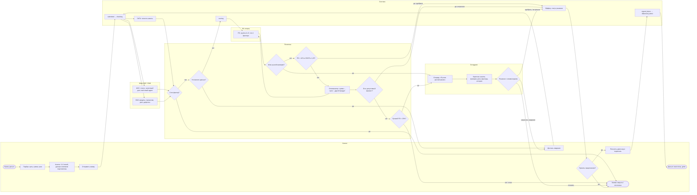

# Процесс: swimlane (D2)

Дорожки: Клиент · Система (конвейер) · Моки ФНС/БКИ · ML-скорер · Политика · Сотрудник.
Обе стороны работают с одной заявкой и одними данными: повторного ввода нет, каждый шаг пишет `status_event`, значимые действия — `audit_event`.

## Что важно показать жюри на этой схеме

1. **Скоринг ≠ решение**: ML-скорер только оценивает риск; решение — в дорожке «Политика», у сотрудника — при ручном рассмотрении.
2. **Отказ — не единственный ответ**: оптимизатор ищет встречное предложение, пограничные случаи уходят сотруднику, недостающие данные запрашиваются.
3. **Одна заявка — одни данные**: сотрудник видит те же проверки и скоринг, что и конвейер; клиент досылает сведения в ту же заявку, проверка повторяется, старые результаты остаются в истории.
4. **Время**: всё, что левее сотрудника, выполняется за доли секунды (метрика Time-to-decision < 1 мин). Допущение MVP: синхронно в запросе подачи, в промышленной версии — воркер с очередью.
